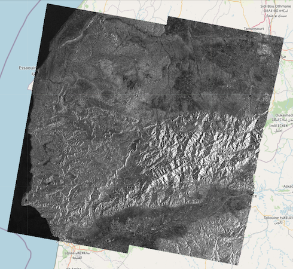
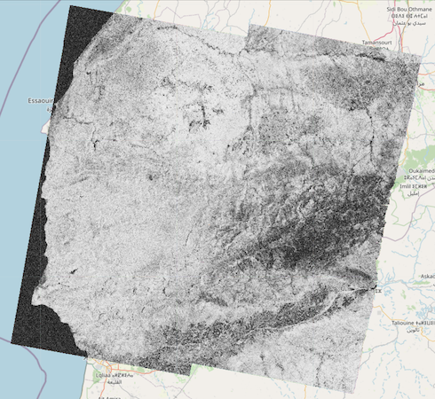
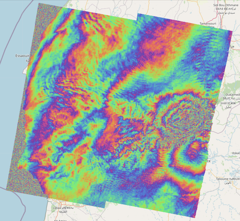
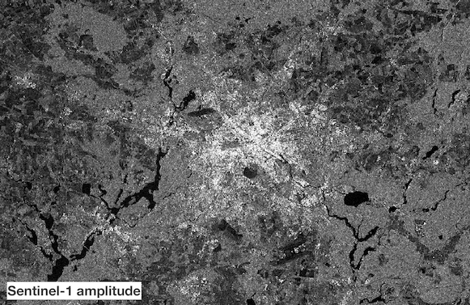
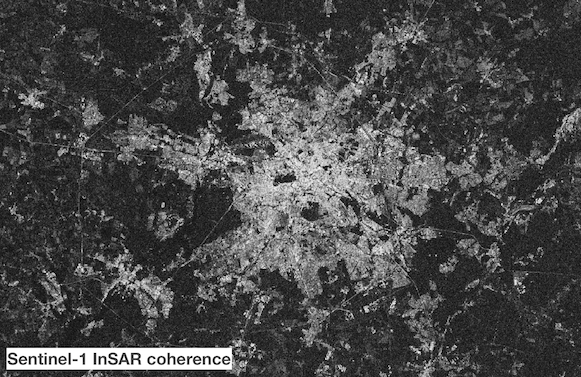
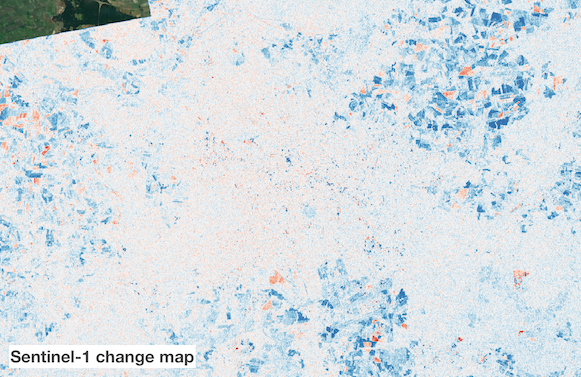
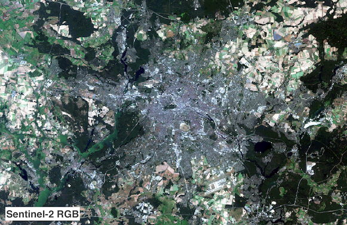
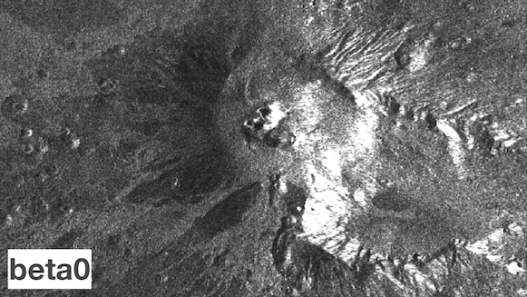
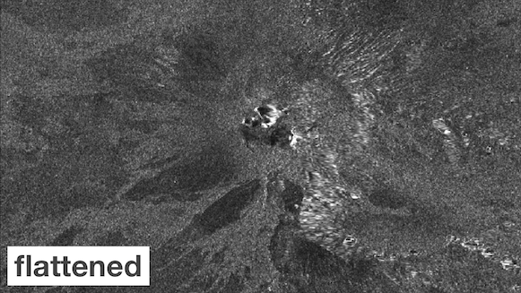

<p float="left">
    
</p>

# A python Earth Observation toolbox

[](https://anaconda.org/conda-forge/eo-tools) [](https://anaconda.org/conda-forge/eo_tools)

EO-Tools is a pure python toolbox that is currently able to search, download and process Sentinel-1 InSAR pairs, geocode and apply terrain correction to Sentinel-1 SLC products, download and mosaic Sentinel-2 tiles and download various publicly available DEM (Digital Elevation Models). The S1 processor can compute phase, amplitude and coherence in the SAR geometry and reproject them in a geographic coordinate system. Example notebooks demonstrating the different features are located in the notebooks-cf folder of the github repository.

## **New**

Sentinel-1 processing is faster through shared geometry across polarizations, optimized interpolation kernels, shared computation of InSAR outputs, and fewer intermediate compression steps. See the [processing optimization notes](https://github.com/odhondt/eo_tools/blob/main/CHANGELOG.md#processing-optimization) for details.

New Lanczos and truncated sinc interpolation kernels are available for SLC coregistration in the InSAR pipeline, with Lanczos now the default. Precomputed lookup tables avoid direct evaluation of kernel weights during remapping, keeping these higher-order kernels efficient.

**Upgrading from an earlier release?** Geocoding LUTs describe geometry and are shared across polarizations. They now use `lut_iw{iw}.tif` filenames. Regenerate your processing outputs, or manually rename one existing LUT per IW before reusing them with `skip_preprocessing=True`. See the [breaking changes and migration instructions](https://github.com/odhondt/eo_tools/blob/main/CHANGELOG.md#breaking-changes), including changes for custom preprocessing and geocoding workflows.

## Features

| Category | Features |
| --- | --- |
| Sentinel-1 InSAR | Compute phase, coherence and amplitudes with TOPS deramping, DEM-assisted coregistration, optional Enhanced Spectral Diversity and burst stitching. Process individual bursts or full products, with optional AOI clipping. |
| Sentinel-1 calibration and geocoding | Geocode SLC amplitudes with Beta or Sigma Nought calibration or radiometric terrain normalization. Build custom pipelines in SAR geometry and geocode their outputs using LUTs. |
| Sentinel-1 polarimetry | Compute dual-polarization H-Alpha decomposition and polarimetric covariance elements. |
| Sentinel-1 partial products | Download only consecutive SLC bursts intersecting an AOI, reducing download size and storage. SAFE-like `.partial.SAFE` products retain their AOI and available bursts, subswaths and polarizations, and work with the InSAR, SLC, H-Alpha and covariance processors. |
| Sentinel-2 | Geocode and mosaic tiles, write individual bands and create color composites such as natural color, CIR and SWIR. |
| DEM | Download, mosaic, crop and upsample publicly available elevation models for an AOI. |
| Output and visualization | Write geocoded Cloud Optimized GeoTIFFs (COGs); display local and remote rasters on Folium maps through TiTiler in the Docker environment, or plot them with xarray in conda notebooks. |
| Discovery and download | Search catalogs and download full products with EODAG; explore product footprints on a Folium map. |

Start with the [partial-product download tutorial](https://eo-tools.readthedocs.io/en/latest/s1-partial-product-download/) and [partial-product processing tutorial](https://eo-tools.readthedocs.io/en/latest/s1-partial-product-processing/), or browse the example notebooks in `notebooks/` (Docker) and `notebooks-cf/` (conda).

## Examples

Here are examples of EO-Tools outputs showing amplitude, coherence and inteferometric phase of a 2023 earthquake in Morocco,
<p float="left">
    <a href="https://raw.githubusercontent.com/odhondt/eo_tools/main/data/ex_amp.png" target="_blank">
        
    </a>
    <a href="https://raw.githubusercontent.com/odhondt/eo_tools/main/data/ex_coh.png" target="_blank">
        
    </a>
    <a href="https://raw.githubusercontent.com/odhondt/eo_tools/main/data/ex_phi.png" target="_blank">
        
    </a>
</p>
a comparison between Sentinel-1 amplitude, coherence, change map using two dates in 2021 and Sentinel-2 RGB image over the city of Berlin in Germany,
<p float="left">
    <a href="https://raw.githubusercontent.com/odhondt/eo_tools/main/data/amp_vh_berlin.png" target="_blank">
        
    </a>
    <a href="https://raw.githubusercontent.com/odhondt/eo_tools/main/data/coh_vh_berlin.png" target="_blank">
        
    </a>
    <a href="https://raw.githubusercontent.com/odhondt/eo_tools/main/data/change_berlin.png" target="_blank">
        
    </a>
    <a href="https://raw.githubusercontent.com/odhondt/eo_tools/main/data/s2_berlin.png" target="_blank">
        
    </a>
</p>
and the comparison between Beta nought calibration and terrain flattening using Copernicus DEM on Sentinel-1 data over Etna.
<p float="left">
    <a href="https://raw.githubusercontent.com/odhondt/eo_tools/main/data/ex_etna_beta0.png" target="_blank">
        
    </a>
    <a href="https://raw.githubusercontent.com/odhondt/eo_tools/main/data/ex_etna_flattened.png" target="_blank">
        
    </a>
</p>

## Install & quick start

- The package comes in two flavors
    - A conda package that contains the main functionality (Sentinel-1 InSAR, Sentinel-2 tile mosaic and DEM download)
    - A docker version (for more advanced users) that additonally works with a TiTiler server for interactive visualization in the notebooks

### Conda install (recommended)

- It is recommended to first create a conda environment to avoid package conflicts
- You need to have `conda` installed (or `mamba` / `micromamba`)
- Then the package can be installed with these commands (replace `conda` by `mamba` or `micromamba` if needed):

```bash
conda create -n eo_tools
conda activate eo_tools
conda install conda-forge::eo-tools 
```

### Docker install

- It works as a dev container for VSCode. 
    - Clone the github repository into the location of your choice.
    - Volumes paths can (and should) be changed in `docker-compose.yml`.
    - After opening the main directory, VSCode should detect the devcontainer file and ask to build the container. Once the container is running, the example notebooks in the `notebooks` directory can be used.
- Alternatively, it should also be possible to start the container from the main directory with `docker-compose up -d` in a terminal and attach to the container with any editor supporting docker.

### Getting started

- Please make sure `jupyter` is installed in your environment
- Example jupyter notebooks demonstrate the different features
- For conda use the notebooks in the `notebooks-cf` directory of the github repository
- For docker use the notebooks in the `notebooks` directory of the github repository
- To be able to download products with EODAG on Copernicus Dataspace, a file named `eodag_config.yaml` containing credentials must be created. The file `eodag_config_example.yml` located in the repository root directory may be used for this purpose. Feel free to copy, rename and edit this file with your credentials. It is recommended to store the file in a secure location outside of the local repository.

### Documentation

Documentation is available on [Read the Docs](https://eo-tools.readthedocs.io/en/latest/).

## Notice

- This project was originally forked from: https://github.com/eo2cube/s1_processor/, however since 99% of the code is now original, I have detached the fork.
- Visualization functions are using TiTiler https://developmentseed.org/titiler/
- Full-product discovery and download use EODAG https://github.com/CS-SI/eodag
- Sentinel-1 partial-product discovery and download use the Copernicus Data Space Ecosystem STAC and S3 services
